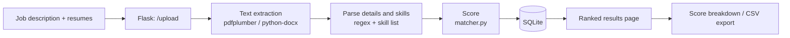

<div align="center">

# Resume Screening and Shortlisting System

**Upload resumes, paste a job description, get a ranked shortlist with an explainable score.**


</div>

---

## Overview

Recruiters often receive hundreds of resumes for a single opening, and reading each one by hand is slow, subjective and hard to repeat. This project automates the **first screening step**.

The user enters a job description and uploads PDF or DOCX resumes. The tool extracts the name, email, phone number, experience and skills from each resume, scores it **out of 100** against the job description, and shows a **ranked shortlist** with a score breakdown that can be exported as CSV.

> **Result:** 41/41 automated tests and 3/3 browser tests passed, and **100 resumes were processed in 3.68 seconds.**

<!-- Add a screenshot or GIF of the ranked shortlist here, for example:
 -->

## Features

- Upload one or many resumes in **PDF** or **DOCX** format
- Paste a job description; required skills and minimum experience are detected automatically
- Extracts **name, email, phone, experience and skills** from each resume
- **Score out of 100** combining skill match, text similarity and experience
- **Ranked shortlist** with a per-candidate breakdown (matched skills, missing skills, sub-scores)
- **CSV export** of the shortlist (opens in Excel)
- Unsupported, empty or corrupt files are **skipped safely** without crashing the app
- Data stays on your own computer; uploads and the database are excluded from Git

## How It Works



### Scoring

**Match Score = 50% x Skill Match + 30% x Text Similarity + 20% x Experience Match**

| Component | Weight | How it is calculated |
| --- | :---: | --- |
| Skill match | 50% | Job-description skills found in the resume / skills required |
| Text similarity | 30% | Cosine similarity of the TF-IDF vectors of the resume and job description |
| Experience match | 20% | Candidate years / required years, capped at 1 (full marks if none required) |

**Worked example:** a job needs 4 skills (Python, Flask, SQL, Git) and 2 years. A candidate has Python, Flask and SQL, 3 years of experience and a text similarity of 0.40.
Skill = 3/4 = 0.75, experience = 1.0 (capped), so score = 0.5 x 0.75 + 0.3 x 0.40 + 0.2 x 1.0 = 0.695, i.e. **69.5 / 100**.

### Recognised skills

Python, Java, C++, SQL, HTML, CSS, JavaScript, React, Flask, Django, machine learning, NLP, Git, MySQL, Excel.
Matching is careful about overlaps, so "Java" is not matched inside "JavaScript". To add a skill, add it to the skills list in `resume_parser.py`.

## Tech Stack

| Layer | Technology |
| --- | --- |
| Front-end | HTML, CSS, JavaScript |
| Back-end | Python, Flask |
| Parsing and matching | pdfplumber, python-docx, scikit-learn (TF-IDF, cosine similarity), regular expressions |
| Database | SQLite |
| Deployment (optional) | gunicorn, Docker, Render |

## Project Structure

```text
Resume-Screening-and-Shortlisting-System/
|-- app.py              # Flask routes (upload, results, export)
|-- resume_parser.py    # text extraction, resume and job description parsing
|-- matcher.py          # scoring
|-- db.py               # SQLite helper functions
|-- templates/          # HTML pages
|-- static/             # CSS and script.js
|-- tests/              # 41 automated tests
|-- uploads/            # uploaded resumes (not in Git)
|-- requirements.txt    # Python dependencies
|-- Procfile            # start command for cloud hosting
|-- Dockerfile          # container image (optional)
|-- .gitignore
`-- README.md
```

## Getting Started

### Requirements

- Python **3.9 or newer**
- A web browser (Chrome, Edge or Firefox)
- Windows 10/11, macOS or Linux; no special hardware and no internet needed to run locally

### Installation

**Windows (Command Prompt)**

```bash
git clone https://github.com/<your-username>/Resume-Screening-and-Shortlisting-System.git
cd Resume-Screening-and-Shortlisting-System
python -m venv venv
venv\Scripts\activate
pip install -r requirements.txt
python app.py
```

**macOS / Linux**

```bash
git clone https://github.com/<your-username>/Resume-Screening-and-Shortlisting-System.git
cd Resume-Screening-and-Shortlisting-System
python3 -m venv venv
source venv/bin/activate
pip install -r requirements.txt
python3 app.py
```

Then open **http://127.0.0.1:5000** in your browser.

If you see an "Address already in use" error, another program is using port 5000. Close it or start the app on a different port.

## Usage

1. Enter the **Job Title** (for example, "Python Developer").
2. Paste the **job description**. Name the required skills and state the experience clearly, for example "3+ years of experience".
3. Choose one or many **PDF or DOCX** resumes (hold Ctrl or Shift to select several).
4. Click **Shortlist Candidates**.
5. Review the ranked list, best match first.
6. Click a candidate to see the **score breakdown**: skill score, text similarity, experience score, matched skills and missing skills.
7. Click **Export** to download the shortlist as a CSV file.

<!-- Add screenshots here, for example:
| Upload page | Ranked shortlist | Score breakdown |
| --- | --- | --- |
|  |  |  |
-->

### Understanding the results

| Field | Meaning |
| --- | --- |
| Match score | Overall score out of 100: 50% skills, 30% text similarity, 20% experience |
| Skill score | Share of the job's required skills that the resume contains |
| Text similarity | How similar the wording of the resume is to the job description |
| Experience score | How well the candidate's years of experience meet the requirement |
| Matched / Missing skills | Required skills found / not found in the resume |
| Rank | Position among all resumes uploaded for this job |

> The score is a guide for ordering candidates, **not a hiring decision**. Always read the top-ranked resumes and make the final decision yourself.

### Tips for best results

- Use **text-based PDFs**; scanned images cannot be read.
- Write skills by their full names from the supported list (for example "machine learning", not "ML").
- State experience as a number, such as "2 years" or "5+ years".
- Use one job description per upload so each shortlist is for a single job.

## Routes

| Method | Route | Description |
| --- | --- | --- |
| POST | `/upload` | Parse, score and save the uploaded resumes |
| GET | `/results/<job_id>` | Show the ranked shortlist |
| GET | `/api/candidate/<id>` | Score breakdown for one candidate (JSON) |
| GET | `/export/<job_id>` | Download the shortlist as CSV |

## Database

One job description has many candidates, and each candidate has one result for that job.

| Table | Key fields |
| --- | --- |
| `job_descriptions` | job_id (PK), title, description, required_skills, min_experience |
| `candidates` | candidate_id (PK), job_id (FK), name, email, phone, education, experience_years, skills, file_name, resume_text |
| `results` | result_id (PK), candidate_id (FK), job_id (FK), match_score, skill_score, text_similarity, experience_score, matched_skills, missing_skills, rank_position |

## Testing

Run the automated tests from the project folder (all 41 should pass):

```bash
python -m unittest discover tests -v
```

| Test type | Total | Passed | Failed |
| --- | :---: | :---: | :---: |
| Automated tests (code) | 41 | 41 | 0 |
| Browser tests (application) | 3 | 3 | 0 |

Six bugs found with unusual resumes were fixed and each was given a regression test.

| Bug | Fix |
| --- | --- |
| Empty resume crashed the parser | Return "Unknown" as the name |
| "Age: 22 years" counted as experience | Ignore age values |
| Skills inside DOCX tables not read | Read table cells too |
| Heading such as "RESUME" became the name | Skip such headings |
| Phone number picked from inside long numbers | Match exactly 10 digits |
| Non-English file names overwrote each other | Add a unique ID to file names |

### Performance

100 resumes (50 PDF and 50 DOCX) were read, analysed and scored in **3.68 seconds**.

## Deployment (optional)

<details>
<summary><b>Render (cloud)</b></summary>

1. Push the code to GitHub (including `requirements.txt` and `Procfile`).
2. On Render choose **New > Web Service** and connect the repository.
3. Build command: `pip install -r requirements.txt`
4. Start command: `gunicorn app:app`
5. Add an environment variable `SECRET_KEY` with a long random value.
6. Click **Create Web Service**.

`Procfile` for Heroku-style platforms:

```text
web: gunicorn app:app
```

Notes: free plans usually have a temporary file system, so uploads and the SQLite database may be erased on restart. Free services may sleep when idle. Use **sample resumes only** on a public demo site.

</details>

<details>
<summary><b>Docker</b></summary>

```dockerfile
FROM python:3.11-slim
WORKDIR /app
COPY requirements.txt .
RUN pip install --no-cache-dir -r requirements.txt
COPY . .
EXPOSE 5000
CMD ["gunicorn", "--bind", "0.0.0.0:5000", "app:app"]
```

```bash
docker build -t resume-shortlister .
docker run -p 5000:5000 resume-shortlister
```

Then open http://localhost:5000. Mount a volume for the folder that holds the database and uploads if you want to keep data between runs.

</details>

**Before deploying:** turn debug mode off (`debug=False`), read `SECRET_KEY` from an environment variable, limit upload size with `MAX_CONTENT_LENGTH`, create the `uploads/` folder automatically, and confirm `.gitignore` excludes `uploads/`, `*.db`, `venv/` and `__pycache__/`.

## Privacy and Security

- Resumes contain personal information. Use the tool only for genuine recruitment and only on trusted computers.
- Uploaded resumes and the database are stored on the computer running the tool. Delete the `uploads/` folder and the database file when shortlisting is finished.
- Never commit uploaded resumes or the `.db` file to GitHub (they are excluded by `.gitignore`).
- There is no login, so run the tool only on a trusted computer or network.

## Limitations

- Only 15 skills are recognised, and education is not extracted yet.
- The candidate name is taken from the first line, so unusual layouts may give a wrong name.
- Scanned (image-only) PDFs cannot be read because OCR is not included.
- Matching is keyword and word-frequency based, so it does not understand synonyms such as "ML".
- Single-user tool with no login or roles.
- Best suited to batches of about 50 to 100 resumes; larger scale needs a server database and a task queue.

## Future Scope

- Education extraction and a larger, editable skills list
- Semantic matching using sentence embeddings
- OCR support for scanned resumes
- User login, roles and a candidate application portal
- Automated deployment (CI/CD) with GitHub Actions

## Project Background

Built as a B.Tech micro-project, taken through problem analysis and requirements, system design, implementation and testing to a documented, deployable tool. The original design (React, PostgreSQL, spaCy, semantic embeddings, CI/CD) was simplified to the stack above so a complete, tested system could be delivered in the available time.

## Authors

- **Arpit Chakravarty** (BTTC25O1016)
- **Pratham Sen** (BTTC25O1050)

Centre for Computer Science and Technology, Madhav Institute of Technology and Science, Gwalior (M.P.), India
Supervisor: **Anil Kumar Fatehpuria**, Assistant Professor
Academic session: July-Dec 2026

## License

<!-- Add a license (for example MIT) if you want others to reuse the code. -->
